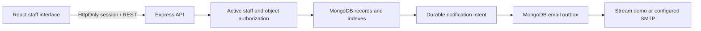

# Project Oasis

React/Vite, Express and MongoDB class administration with student records, enrollment, QR-assisted attendance, grades, fee tracking and email notifications. No student-count, attendance-speedup, production-use or payment-gateway result is asserted.

## Architecture



Accounts are administrators or teachers; students are records, not authenticated portal users. Administrators control staff, enrollments and finance. Active teachers must be explicitly linked to a Teacher document and can access only assigned classes and enrolled students. Grade publishing and attendance enforce those boundaries. See [permissions and upgrades](SECURITY_AND_UPGRADES.md) for the complete matrix.

Human IDs allocate atomically from the greatest existing suffix, preserving existing IDs and gaps. Repeated grade publication and mark-paid requests preserve event timestamps. Receipts use the recorded payment amount. Email and printable student details escape HTML values. Notification intent and a bounded, leased outbox support retries; SMTP acceptance is not an exactly-once delivery guarantee. Schema indexes are implemented; no measured query-speed claim is made.

## Disposable fictional demonstration

Use Node.js 24.22.3 or a later patched 24.x release, and npm. From `backend`:

```bash
npm ci
npm run demo
```

This starts an ephemeral loopback MongoDB and API on port 5055 with fictional `example.test` accounts and stream-only mail. It overrides inherited database/SMTP settings. The process prints demo credentials; these are only for its disposable database. The initial MongoDB binary download needs internet or an existing writable cache.

From `frontend`, set `VITE_API_URL=http://127.0.0.1:5055/api` in your local, untracked `.env`, then:

```bash
npm ci
npm run dev -- --host 127.0.0.1 --port 5175 --strictPort
```

Open `http://127.0.0.1:5175`; keep the same hostname for the cookie. The demo allows this exact frontend origin. [Public screenshots](docs/screenshots/README.md) use fictional records. The legacy `seed` and `seed:reset` commands now start this same disposable demo; they never drop an existing database.

## Normal local setup

Use a dedicated MongoDB database. Copy `backend/.env.example` to an untracked `.env`, select your own database URI and random JWT secret, then `npm ci && npm start`. The default backend port is 5000. Review `utils/createAdmin.js` and `CreateAdminUser.txt` before explicitly bootstrapping the first administrator; no reusable admin password is supplied. Set the frontend's `VITE_API_URL` to that API's `/api` root and run Vite. `GET /api/health` checks the imported application.

Session cookies are HttpOnly and expire; the browser stores no JWT or user record in local storage. Legacy JWTs require sign-in again. Production requires HTTPS, an explicit `ALLOWED_ORIGINS` list and a random 32+ character JWT secret. The default `SESSION_SAME_SITE=lax` favors a same-site frontend/API. A separately reviewed cross-site configuration may use Secure `none` cookies but can still be affected by third-party-cookie restrictions. Password changes require the current password and revoke old sessions.

Normal SMTP uses `SMTP_HOST`, `SMTP_PORT`, `SMTP_USER`, `SMTP_PASS` and optional `SMTP_FROM`. `EMAIL_MODE=stream` and `NODE_ENV=test` prevent delivery. The normal server retries pending notifications; monitor failed jobs and retain student-containing mail data privately. Never use real student data or SMTP credentials for screenshots or tests.

## Verification

```bash
# backend
npm test
npm run check
# frontend
npm run lint
npm run build
```

Integration tests start disposable MongoDB, a random loopback API port, fictional records and an in-memory mail transport. They cover authorization, inactive accounts, object isolation, QR/attendance, concurrent IDs and publication, timestamps, receipts, escaping, session revocation, CORS and failed-mail retry. They do not prove live email delivery, real student usage or attendance performance. Frontend/backend are JavaScript; there is no TypeScript project to typecheck. CI validates without deploying. Test real camera permission, SMTP and an isolated restore before operating with real users/data.

No production database was seeded, reset, migrated or accessed for verification. Read [security and data-preserving upgrades](SECURITY_AND_UPGRADES.md) before installing over existing data.
